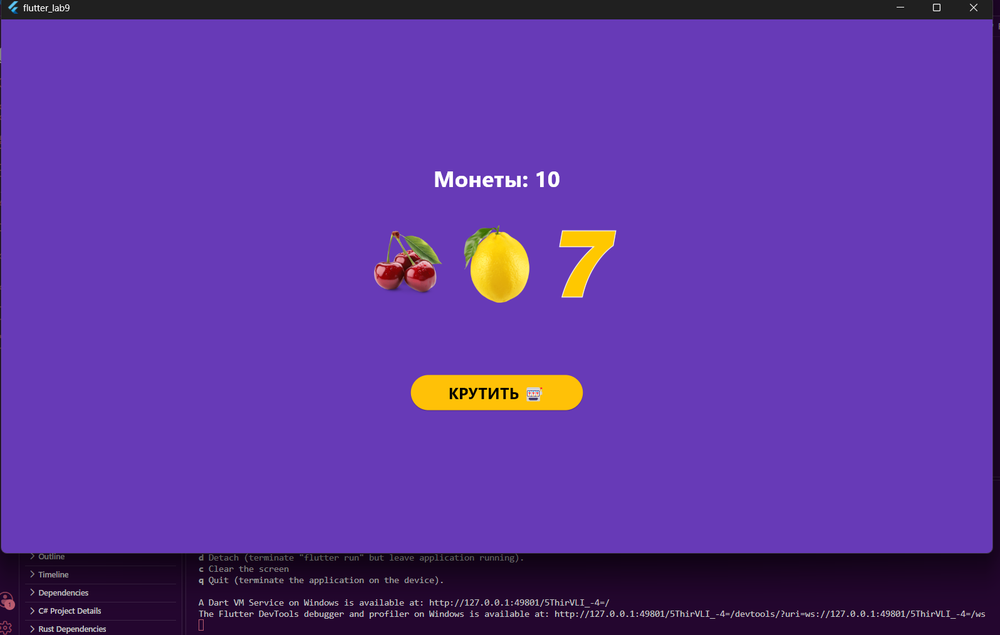

# Лабораторная работа №9

ФИО: Каторжин Максим Вячеславович
Группа: ИСП-241
Дата: 26.10.2026

Что я сделал:
- Сделал слот машину на Flutter.
- Научился использовать StatefulWidget и setState.
- Подключил картинки через pubspec.yaml.
- Добавил анимацию кручения барабанов и счетчик монет.

Скриншот:

Как запустить:
1. Скачать проект.  
2. В терминале написать: flutter pub get
3. Потом: flutter run -d chrome